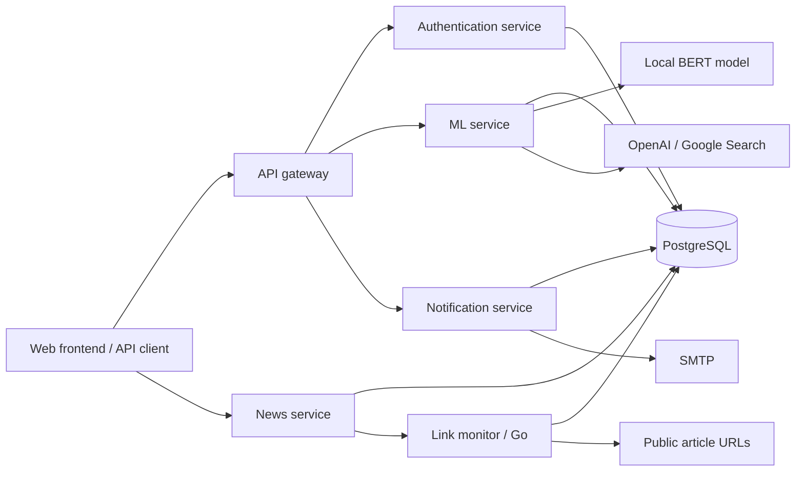

# HealthCheck Backend

**Health news analysis with BERT, structured article data, and user notifications.**

HealthCheck helps users examine health-related news by classifying article text, collecting source information, and keeping a history of their consultations. This repository contains the API gateway and backend services; the web frontend is maintained separately.

The backend combines Node.js application services, a Python service for machine learning and article extraction, and a Go service for manual link monitoring. PostgreSQL stores users, articles, classifications, model metadata, and notification preferences.

## Capabilities

- **Article analysis:** submit text or a URL for BERT classification, topic assignment, and keyword extraction.
- **News management:** browse and search articles, manage sources and topics, record interactions, and submit reports.
- **User accounts:** register, sign in with JWT authentication or Google OAuth, and manage profiles.
- **Consultation history:** retrieve and delete a user's previous consultations.
- **Notifications:** email delivery and scheduled site announcements; SMS and legacy notification HTTP routes are retired.
- **Link monitoring:** administrators manually check original article URLs, follow progress, and review persisted availability results through the Go service.
- **Model management:** train models, list versions, and select an active model.
- **Content collection:** collect Google News articles and X/Twitter posts through scraper endpoints and scheduled jobs.
- **Conversational assistance:** investigate news with a LangChain chatbot connected to OpenAI and Google Custom Search.

## Architecture

Each service runs as a separate process. The gateway exposes authentication, ML, and notification routes. The news API currently runs separately and is accessed directly.



| Component | Stack | Local port | Purpose |
| --- | --- | --- | --- |
| API gateway | Express, TypeScript | `4000` | Forwarding, authentication checks, rate limiting |
| Authentication | Express, Passport, Sequelize | `3001` | Accounts, JWT, Google OAuth |
| News | Express, Sequelize, TypeScript | `3003` | Articles, search, reports, statistics, history |
| Notifications | Express, Nodemailer | `3004` | Email worker and site announcements; preferences are owned by Auth |
| Machine learning | Flask, PyTorch, Transformers, LangChain | `5000` | Classification, training, scraping, chatbot |
| [Link monitor](services/link-monitor-service/README.md) | Go, pgx | `3005` | Manual URL checks, progress, results, recovery |

The frontend runs on `3000`. News validates sessions through Auth and calls the monitor internally using `LINK_MONITOR_URL` and a shared server-only token. The browser never calls Go directly.

## Repository layout

```text
HealthcheckBack/
├── api-gateway/                  # Gateway routes and middleware
├── services/
│   ├── auth-service/             # Authentication and profiles
│   ├── news-service/             # News, interactions, and history
│   ├── notification-service/     # Notification delivery and scheduling
│   └── ml-service/
│       ├── api/routes/           # Classification, training, and chat APIs
│       ├── core/                 # Model loading and inference
│       ├── database/             # SQLAlchemy models and connection
│       ├── models/               # BERT weights and tokenizer assets
│       ├── scrapers/             # Google News and X/Twitter collection
│       └── utils/                # Article extraction and data processing
├── db.sql                        # PostgreSQL schema
└── .gitignore
```

## Local setup

### 1. Prerequisites

Install Git with Git LFS, Node.js with npm, Python with pip and virtual environment support, PostgreSQL, and Go 1.25 or newer (the monitor module declares its minimum version). Runtime versions are not pinned at repository level. Python dependencies are pinned in [requirements.txt](services/ml-service/requirements.txt), and Node.js services include npm lockfiles.

External integrations use Google OAuth, OpenAI, Google Custom Search, and SMTP. Twilio is no longer required. Configure credentials for the services you start; some clients, including the ML chatbot, are initialized at startup.

### 2. Clone and download model weights

```bash
git lfs install
git clone https://github.com/AndrewMtz23/HealthcheckBack.git
cd HealthcheckBack
git lfs pull
git lfs ls-files
```

The BERT weights use Git LFS. `pytorch_model.bin` and `model.safetensors` total approximately **879 MB**, excluding dependencies. Tokenizer and model configuration files are tracked in regular Git.

### 3. Create the database

With PostgreSQL running, execute from the repository root:

```bash
createdb -U postgres healthcheck
psql -U postgres -d healthcheck -f db.sql
```

Use an empty database: the SQL file creates types and tables and is not a repeatable migration script. It does not seed an active ML model. Classification requires an active record in `modelos_ml`, in addition to the model files on disk; provision this metadata before testing predictions.

### 4. Configure the services

Create a `.env` file inside each service directory and inside `api-gateway/`. These files are ignored by Git.

Authentication, news, notifications, ML, and the Go monitor use the same application database settings:

```dotenv
DB_HOST=localhost
DB_PORT=5432
DB_NAME=healthcheck
DB_USER=postgres
DB_PASSWORD=replace-with-your-local-password
```

Additional settings are listed below. Follow the source links for the configuration definitions.

| Service | Settings |
| --- | --- |
| [Gateway](api-gateway/src/config/index.ts) | `PORT=4000`, `JWT_SECRET`, `ALLOWED_ORIGINS=http://localhost:3000`, `AUTH_SERVICE_URL=http://localhost:3001`, `ML_SERVICE_URL=http://localhost:5000`, `NOTIFICATIONS_SERVICE_URL=http://localhost:3004` |
| [Authentication](services/auth-service/src/config/env.ts) | `PORT=3001`, `JWT_SECRET`, `JWT_EXPIRATION=86400`, `FRONTEND_URL=http://localhost:3000`, `GOOGLE_CLIENT_ID`, `GOOGLE_CLIENT_SECRET`, `GOOGLE_CALLBACK_URL=http://localhost:3001/api/auth/google/callback` |
| [News](services/news-service/src/config/index.ts) | `PORT=3003`, `JWT_SECRET`, `FRONTEND_URL=http://localhost:3000`, `AUTH_SERVICE_URL=http://localhost:3001`, `LINK_MONITOR_URL=http://127.0.0.1:3005`, `LINK_MONITOR_INTERNAL_TOKEN` |
| [Notifications](services/notification-service/src/config/) | `PORT=3004`, `FRONTEND_URL=http://localhost:3000`, `EMAIL_HOST`, `EMAIL_PORT`, `EMAIL_SECURE`, `EMAIL_USER`, `EMAIL_PASS` |
| [ML](services/ml-service/config.py) | `SECRET_KEY`, `MODEL_PATH=models/bert_health_model`; chatbot: `OPENAI_API_KEY`, `GOOGLE_API_KEY`, `GOOGLE_CX` |

Use the same `JWT_SECRET` in the gateway, authentication, and news services. Register the configured Google callback URL in your OAuth application. The ML development server uses port `5000` in `app.py`.

### Start all services from the shared Windows workspace

When this repository and `HealthcheckFront` are siblings, use `../iniciar-healthcheck.bat`. It starts **seven processes**: frontend, gateway, auth, news, notifications, ML and link monitor. The root BAT/scripts are workspace files, not included when cloning this repository alone.

```bat
iniciar-healthcheck.bat --preview
iniciar-healthcheck.bat --check
iniciar-healthcheck.bat
```

`--preview` prints ports and connections without starting anything. `--check` validates installed dependencies, local DB configuration, Go and free ports. Default startup compiles TypeScript/Go and opens seven terminals in local mode: manual ML predictions and link checks are enabled; email delivery and automatic scraping remain disabled. `--diagnostic` explicitly blocks predictions and new link checks.

Both modes use `scripts/local-service-env.cjs` and DB settings in ignored `.env.phase00`. Normal startup uses `scripts/local-run.cjs` and generates persistent private JWT, gateway/ML and News/Go secrets in ignored `.env.local-runtime`. Keep that file between restarts; replacing it invalidates existing sessions. Browser API URLs are `http://localhost:4000/api` and `http://localhost:3003/api`. The monitor reports health 503 until its schema/configuration is ready.

ML requires a registered active model whose artifacts exist in `services/ml-service/models/model_<version>`; the original `bert_health_model` directory alone is not an active registry entry. Register only verified artifacts and do not invent evaluation metrics. Public ML `/health` reports process liveness; it does not authorize operations or guarantee model readiness.

For normal manual monitoring, apply `services/link-monitor-service/sql/001_link_monitor.sql` explicitly to the confirmed database, configure matching private tokens in News and Go, and run those services outside diagnostic mode. The migration is also required after creating a new database from `db.sql`. See the [monitor setup and API](services/link-monitor-service/README.md). Never apply `db.sql` to an existing populated database.

### 5. Start the Node.js services

Open a separate terminal in each directory:

```text
api-gateway/
services/auth-service/
services/news-service/
services/notification-service/
```

Run in each terminal:

```bash
npm ci
npm run dev
```

The TypeScript services also provide `npm run build` and `npm start` to compile and run their JavaScript output. Notifications runs JavaScript directly with `npm start`.

### 6. Start the ML service

From `services/ml-service/`, create a virtual environment:

```bash
python -m venv .venv
```

Activate it on Windows PowerShell:

```powershell
.\.venv\Scripts\Activate.ps1
```

Or on macOS/Linux:

```bash
source .venv/bin/activate
```

Install dependencies and start Flask:

```bash
python -m pip install -r requirements.txt
python app.py
```

`flask-cors` is included in the updated requirements file. Initial startup also downloads NLTK resources and requires internet access. Run from the service directory so relative model paths resolve correctly.

## API reference

These are representative routes. Consult each service's route modules for request schemas, access requirements, and the full endpoint list.

| Service / port | Method | Path | Purpose |
| --- | --- | --- | --- |
| Gateway / `4000` | `GET` | `/health` | Gateway health |
| Authentication / `3001` | `POST` | `/api/auth/register` | Create an account |
| Authentication / `3001` | `POST` | `/api/auth/login` | Sign in |
| Authentication / `3001` | `GET` | `/api/auth/profile` | Retrieve the authenticated profile |
| News / `3003` | `GET` | `/api/health` | News service health |
| News / `3003` | `GET` | `/api/news` | List articles |
| News / `3003` | `GET` | `/api/history` | Retrieve consultation history |
| Notifications / `3004` | `GET` | `/` | Notification service health |
| ML / `5000` | `POST` | `/api/ml/classify/predict` | Analyze text or an article URL |
| ML / `5000` | `POST` | `/api/ml/train/train` | Start model training |
| ML / `5000` | `GET` | `/api/ml/train/models` | List models |
| ML / `5000` | `POST` | `/api/ml/chatbot/chat` | Send a chatbot message |

Protected routes expect `Authorization: Bearer <token>`. The gateway requires authentication for prediction requests. The example below uses the direct local ML interface; classification writes article and classification records to PostgreSQL.

```http
POST /api/ml/classify/predict HTTP/1.1
Host: localhost:5000
Content-Type: application/json

{
  "text": "Paste the health news article to analyze here."
}
```

For URL analysis, replace `text` with a `url` field containing the article address. The classifier uses the labels `verdadera` and `falsa`. Its reported score is the model's probability for the `verdadera` class, expressed as a percentage; it is not necessarily the probability of the predicted class.

## Development notes

- **Model evaluation:** the repository does not publish benchmark results or calibrated accuracy claims. Predictions are model output requiring source verification.
- **Startup behavior:** ML starts scheduled scraping jobs, and notifications processes pending work on startup. Use a development database and appropriate integration accounts.
- **Deployment:** `python app.py` enables Flask debug mode. There is no complete container setup; the ML `Dockerfile` is currently empty.
- **Verification:** auth/news/gateway builds passed on 2026-10-06; isolated integration passed 46 administrative and 26 profile HTTP checks. Provider delivery, live OAuth and a complete browser end-to-end flow remain unverified.

## Contributing

Keep changes scoped to the affected service, document configuration or API changes, and include the checks used to verify behavior. Commit lockfile updates when changing Node.js dependencies. Keep credentials, virtual environments, generated models, and runtime output out of commits; the bundled BERT weights remain tracked through Git LFS.

## Attribution and license metadata

This repository preserves the backend history extracted from the original HealthCheck project. Existing contributor attribution and package license declarations are retained. Node.js packages declare `ISC` in their manifests; a standalone repository-wide license file is not currently included.

## Administrative and personal APIs

Auth exposes GET/POST `/api/auth/admin/users` and PATCH `/api/auth/admin/users/:id`, with active administrator checks against the database, last-admin protection and image URL support. Only `admin` and `usuario` roles exist.

GET/PUT `/api/auth/profile` supports `nombre`, `telefono`, `imagen_url`. Images are optional HTTP/HTTPS URLs up to 2048 characters with no embedded credentials; null/empty removes the image. No upload or server-side image fetching is implemented. Login and registration return complete editable profile data.

Authenticated routes under `/api/auth/profile`: GET/PUT `/preferences`, GET/POST `/topics`, DELETE `/topics/:topicId`, GET `/notifications`, DELETE `/notifications/:notificationId`. User identity comes from the session. Preference reads do not create rows; writes serialize on the user; notifications are owner-scoped. The current frontend profile uses these routes instead of the legacy notification service.

News exposes `/api/admin/summary`, `/news`, `/news/:id`, `/sources`, `/topics`, `/reports`, `/activity`, `/models`, `/notifications` and `/preferences`. Users belong to Auth. Sources/topics allow create/edit; reports allow resolution with an idempotent reliability adjustment. Other modules are read-oriented. Gateway CORS permits PATCH for administrative user edits while preserving the allowed-origin restriction.

## Local runtime and schema boundaries

The authorized local database is `localhost:5432/healtcheckbd`. Neon was deferred; no remote recovery or migration is claimed. Sequelize, existing SQL and SQLAlchemy remain; Prisma is not installed.

`db.sql` now includes nullable `usuarios.imagen_url VARCHAR(2048)`. Existing local data also has `noticias.fecha_analisis` and the `dudosa` classification enum value; these news additions are not yet reflected in db.sql. Do not treat the SQL file as a complete current database baseline, and do not apply it to an existing populated database. Reconcile the actual catalog before migration.

With `HEALTHCHECK_DIAGNOSTIC=1`, ML blocks prediction/training/scraping/chat and skips the scheduler; notifications blocks delivery, SMTP verification, scheduling and non-allowlisted HTTP operations. This is the mode used for local checks. Normal runtime can have external effects. Saving preferences does not prove delivery.

Build auth/news/gateway before running `node --test tests/*.test.cjs`. The published Node suites contain 10 tests; the local workspace has an additional untracked diagnostic configuration test (11 total). `python tests/test_ml_safety.py` checks two runtime guards. `node tests/admin-integration.cjs` requires an isolated PostgreSQL cluster on 127.0.0.1:55432 with role phase00, synthetic password unused, and data_directory equal to the workspace `.healthcheck-logs/phase00-pg`. It creates a fresh synthetic database and rejects other clusters; it must never target the application database. Local setup/probe scripts and fixtures are intentionally not part of the published branch.

## Published feature branch

`feat/admin-profile-platform` was pushed with four feature commits on 2026-10-06; last verified remote commit: `88376b5`. No merge or PR was performed in that session. README and other Markdown updates remain local and are not authorized for upload.


## Actualización local — 2026-10-07

Twilio retirado de notification-service. Las rutas HTTP heredadas de notificaciones están retiradas; usar las rutas autenticadas propias de Auth. Solo se aceptan nuevas preferencias email, sin convertir SMS existentes. Historial corregido: conteo, última clasificación, fechas y paginación. Ver `../Docs/User/verificacion.md` (local). Sin Prisma ni cambios de esquema en esta entrega.

## GitHub Actions

`ci.yml` runs on pull requests to `main`, pushes to `main` and feature/chore branches, and manual dispatch. Node service builds and regressions, Python offline route/ORM tests, and Go formatting/vet/race/build with disposable PostgreSQL 17.

`codeql.yml` analyzes the repository languages and GitHub Actions on the same events and weekly after integration into the default branch. Official actions are pinned to commit SHAs; CI has read-only repository permissions, dependency caches, timeouts and cancellation of superseded runs. CodeQL has permission to upload security findings.

The workflows do not deploy, use application credentials, train models or send notifications. Existing lint warnings remain visible; errors fail the job.

Python CI installs CPU-only PyTorch plus `services/ml-service/requirements-ci.txt`, constrained to runtime versions. It does not fetch BERT weights. Monitor integration uses a disposable `link_monitor_test_ci` database and a matching PGDATA suffix so the destructive-test safeguards stay enabled; no application database is involved.

CI graph: Node compilation feeds regression tests through build artifacts; Go checks feed PostgreSQL integration and then binary compilation. Python regressions run independently.

## Local schema and source access

The notification center also requires `services/notification-service/sql/system-announcements.sql`. Apply this reviewed migration explicitly in a transaction after backing up the intended database; missing announcement tables cause inbox and active-announcement queries to fail. The startup launcher does not migrate schemas. This migration creates no announcements or email deliveries.

Some article sources refuse automated downloads with HTTP 401/403. Prediction returns `422 SOURCE_ACCESS_DENIED` with guidance to use the Text tab in that case, preserving SSRF protection and access restrictions. This is distinct from an unavailable ML model and does not save a classification or history entry.
